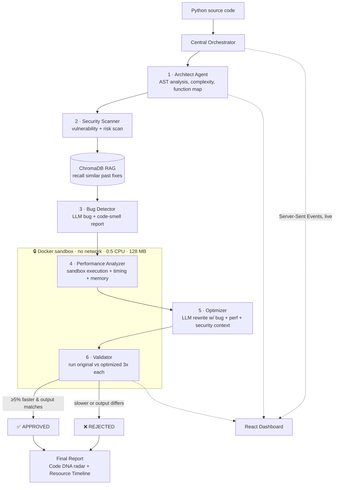
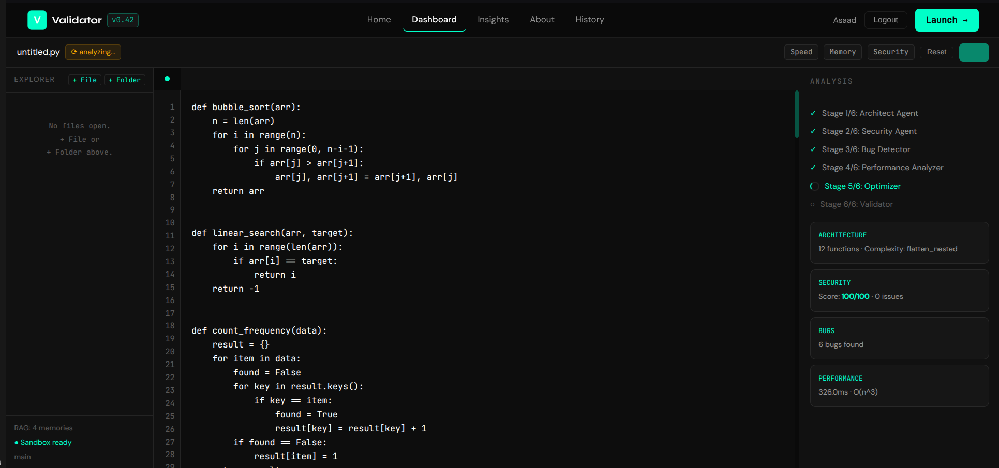
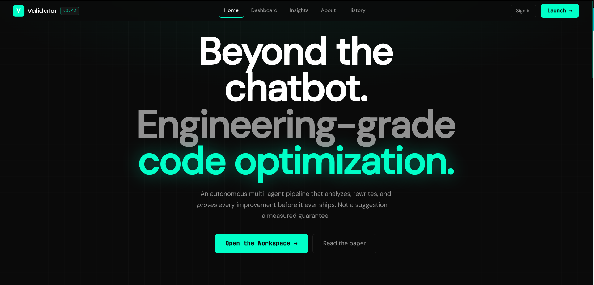
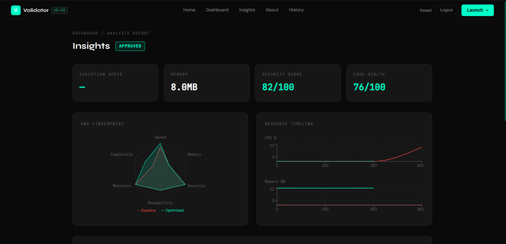
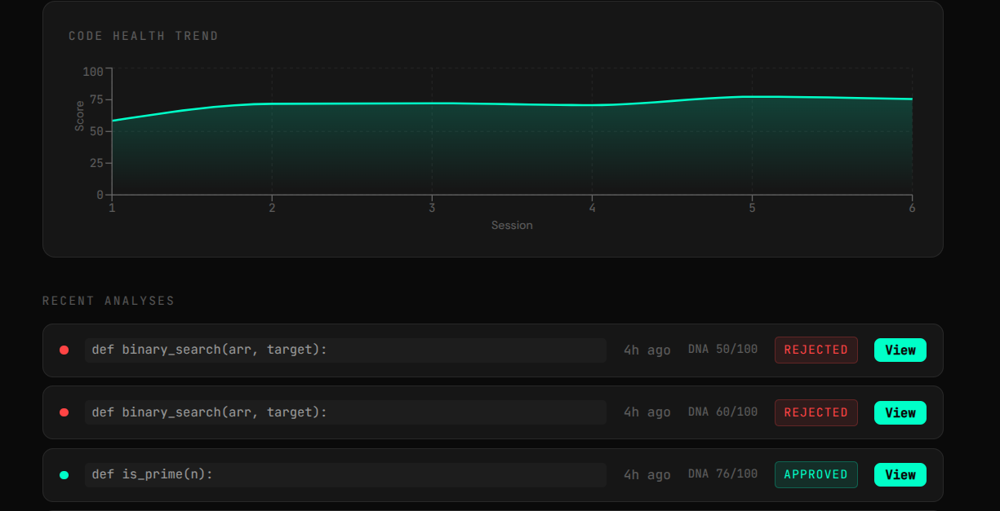

# 🤖 Autonomous AI Code Performance & Debugging Analyst


> Copilot and ChatGPT _suggest_ code changes. They never _run_ them.
> This system optimizes your Python — then **proves** the optimization is real by
> executing the original and the rewrite in a locked-down sandbox and comparing
> timing and output, byte for byte.

A multi-agent AI pipeline that analyzes Python for bugs and performance problems,
rewrites it with an LLM, and **validates** the result through sandboxed execution —
closing the "suggest but never verify" gap left by conventional AI coding assistants.

Built as the Software Engineering capstone (WEX 428) at **OSTİM Technical University**, May 2026.

---

## 🎯 Key Results

On a 150-line, 6-function benchmark where every function was accidentally O(n²):

| Metric          | Result                                             |
| --------------- | -------------------------------------------------- |
| **Speedup**     | **77.1% faster** (measured, sandbox-averaged)      |
| **Correctness** | **Byte-identical output** to the original          |
| **Complexity**  | All 6 functions rewritten to **O(n) / O(n log n)** |
| **Verdict**     | `APPROVED` — improvement proven, not assumed       |

**Every optimization is guaranteed, not guessed.** The validator runs the original and
the optimized code **3× each** in the sandbox, averages the timing, and requires a **≥5%
speedup with matching output** before it will report `APPROVED`. Anything slower than
−5%, or with mismatched output, is `REJECTED`.

---

## ⚙️ How It Works — The 6-Stage Pipeline

A single request streams live through six specialized agents plus a central
orchestrator. Stage results are pushed to the UI over Server-Sent Events as they
complete, so you watch the analysis happen in real time.




_Live 6-stage pipeline streaming results via SSE — Optimizer running, 4 stages complete_

**Signature outputs**

- **Code DNA Fingerprint** — a 6-axis radar (complexity, security, performance,
  readability, bug density, optimization) comparing original vs optimized at a glance.
- **Resource Timeline** — CPU and RSS memory sampled every 100 ms during execution.
- **RAG memory** — a ChromaDB engine that learns from past optimizations and surfaces
  similar prior fixes as context for the Optimizer.

---

## 📸 Screenshots


_Landing page_


_Insights report: APPROVED verdict, Code DNA Fingerprint (baseline vs optimized), Resource Timeline_


_Code health trend across analysis sessions_

---

## 🧱 Tech Stack

| Layer           | Technology                             |
| --------------- | -------------------------------------- |
| Backend         | Python · FastAPI · Uvicorn             |
| AI / LLM        | OpenAI `gpt-4o-mini`                   |
| Data contracts  | Pydantic schemas (typed, end to end)   |
| Knowledge / RAG | ChromaDB                               |
| Sandbox         | Docker (no network · 0.5 CPU · 128 MB) |
| Streaming       | Server-Sent Events (SSE)               |
| Frontend        | React · Vite                           |
| Auth & storage  | Supabase                               |

---

## 🚀 Quick Start

**Prerequisites:** Python 3.11+, Node 18+, Docker.

### 1. Backend

```bash
# from the repo root
cp .env.example .env          # then fill in the keys below

# .env:
#   OPENAI_API_KEY=sk-...
#   SUPABASE_URL=https://<project>.supabase.co
#   SUPABASE_ANON_KEY=<anon-key>

docker build -t code-sandbox .          # required — validation runs code in this image
pip install -r requirements.txt
python main.py                          # API on http://localhost:8000
```

### 2. Frontend

```bash
cd frontend
npm install
npm run dev                             # open http://localhost:5173
```

---

## 👥 Team & Credits

- **Asaad Suliman Idris** — System Architect: orchestrator, validator, Pydantic schemas, system integration
- **Ibrahim Abdu Sutota** — AI & Knowledge Engineer: Bug Detector, Optimizer agents, prompt engineering, RAG pipeline
- **Omar Abdulkadir Nur Hassan** — Performance Engineer: Docker sandbox, code executor, performance measurement, AST analysis
- **Abdulkadir Khalif Hassan Wasuge** — Frontend & Integration Engineer: React UI, Supabase auth, FastAPI integration

**Advisor:** Prof. Dr. Yücel Tekin — OSTİM Technical University
Software Engineering Capstone (WEX 428), May 2026

---

## ⚠️ Limitations & Future Work

**Known limitations**

- **Non-deterministic code** (functions using `random`, wall-clock time, etc.) can
  trigger false `REJECTED` verdicts, because the validator compares outputs across runs
  and those outputs legitimately differ each time.

**Future work**

- Support for more languages beyond Python
- Cloud deployment
- A VS Code extension for in-editor analysis
